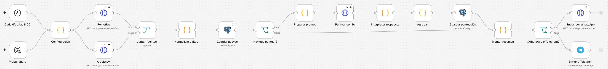
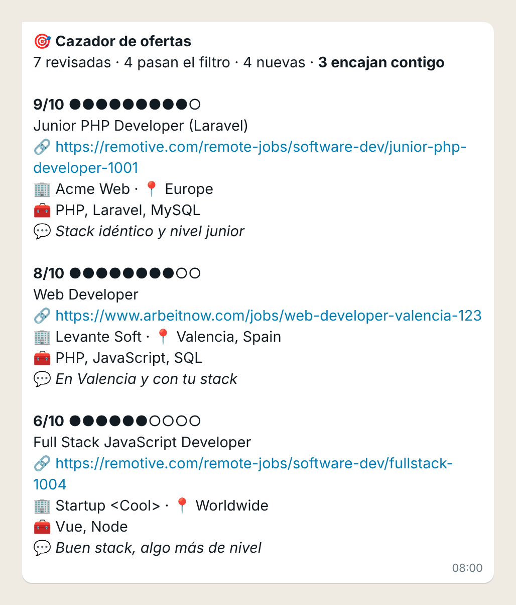
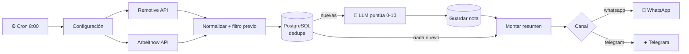

# 🎯 Cazador de ofertas · n8n + IA + PostgreSQL

Automatización hecha con **n8n** que cada mañana revisa ofertas de empleo de desarrollo web, descarta las que no encajan, **puntúa el resto con IA según mi perfil** y me manda por **WhatsApp** (o Telegram) un resumen con las mejores.



<p align="center">
  
</p>

## Qué hace

1. **Descarga** ofertas de dos APIs públicas: [Remotive](https://remotive.com) (remoto) y [Arbeitnow](https://www.arbeitnow.com) (Europa).
2. **Normaliza** los dos formatos a uno común y limpia el HTML de las descripciones.
3. **Aplica un filtro previo sin IA**: palabras clave del stack, títulos senior/lead fuera y ubicaciones compatibles. Así no se gastan llamadas a la IA en ofertas que no tienen sentido.
4. **Deduplica en PostgreSQL** con `INSERT … ON CONFLICT DO NOTHING`, para que una oferta no se procese dos veces.
5. **Puntúa cada oferta nueva de 0 a 10** con un LLM (cualquier API compatible con OpenAI). La IA devuelve un JSON con nivel, tecnologías y el motivo de la nota.
6. **Guarda** la puntuación y **envía** por WhatsApp las que superan la nota mínima. El canal se elige en la configuración: WhatsApp (con [CallMeBot](https://www.callmebot.com)) o Telegram, y el mensaje se formatea para cada uno.

Si la IA falla (límite de peticiones, caída…), la oferta se queda sin nota y **se reintenta en la siguiente ejecución**. Si una fuente cae, el resto sigue funcionando. Y si falla el workflow entero, un segundo workflow avisa por WhatsApp.



## Tecnologías

| | |
|---|---|
| Orquestación | n8n 2.x (self-hosted) |
| Lógica | JavaScript (nodos Code) |
| Base de datos | PostgreSQL 17: esquema propio, CTEs, `jsonb_to_recordset`, vistas |
| IA | API compatible con OpenAI (por defecto Groq, que tiene plan gratuito) |
| Avisos | WhatsApp (CallMeBot) o Telegram |
| Infraestructura | Docker Compose |
| Tests | `node:test` (unitarios) + test e2e con un servidor falso |

## Puesta en marcha

**Requisitos:** Docker, una clave de API de IA y WhatsApp (o un bot de Telegram).

```bash
git clone https://github.com/pablopedron/n8n-workflow.git
cd n8n-workflow
cp .env.example .env          # rellena la contraseña y N8N_ENCRYPTION_KEY (openssl rand -hex 32)
docker compose up -d
```

Abre http://localhost:5678, crea tu usuario y después:

1. **Importa los workflows** desde *Workflows → Import from file*: `workflows/cazador-ofertas.json` y `workflows/avisos-de-error.json`.
2. **Crea las credenciales:**
   - **Postgres**: host `postgres`, base de datos `n8n`, usuario y contraseña los de tu `.env`.
   - **Header Auth** (para la IA): name `Authorization`, value `Bearer TU_CLAVE`. Puedes sacar una clave gratis en [console.groq.com](https://console.groq.com/keys).
   - **WhatsApp (CallMeBot)**: sigue los pasos de [su web](https://www.callmebot.com/blog/free-api-whatsapp-messages/). Guardas su número en tus contactos, le mandas *"I allow callmebot to send me messages"* y te contesta con tu `apikey`. En n8n crea una credencial **Query Auth** con name `apikey` y value tu clave, y úsala en *Enviar por WhatsApp* y en el workflow de avisos de error.
   - **Telegram** (opcional): el token que te da [@BotFather](https://t.me/BotFather). Para saber tu `chat_id`, escribe a tu bot y abre `https://api.telegram.org/bot<TOKEN>/getUpdates`.
3. **Edita el nodo `Configuración`**: tu perfil, palabras clave, nota mínima, `aviso` (`'whatsapp'` o `'telegram'`) y tu `whatsappTelefono` (con prefijo, por ejemplo `+34600111222`). Pon también tu teléfono en el workflow de avisos de error.
4. Pulsa **Probar ahora** y, cuando funcione, **publica/activa** el workflow. En *Settings* del workflow principal puedes elegir el de avisos como *Error workflow*.

## Consultas útiles

Las ofertas se quedan guardadas, así que también sirven para analizar el mercado:

```sql
SELECT * FROM cazador.pendientes LIMIT 10;               -- mejores ofertas sin revisar
SELECT * FROM cazador.tecnologias_mas_pedidas LIMIT 15;  -- qué tecnologías se piden más
UPDATE cazador.ofertas SET estado = 'aplicada' WHERE id = 42;
```

Tienes más en [`db/consultas.sql`](db/consultas.sql). Para abrir la consola: `docker compose exec postgres psql -U n8n -d n8n`.

## Estructura

```
├── docker-compose.yml          n8n + PostgreSQL
├── db/
│   ├── init/01-schema.sql      tablas y vistas (se aplican al crear el contenedor)
│   └── queries/                SQL que ejecutan los nodos Postgres
├── src/                        JavaScript de cada nodo Code
├── scripts/build-workflow.mjs  genera workflows/*.json a partir de src/ y db/queries/
├── workflows/                  workflows listos para importar en n8n
└── tests/
    ├── code-nodes.test.mjs     tests unitarios de los nodos Code
    └── e2e/                    ejecuta el workflow real contra APIs simuladas
```

El código de los nodos no se edita dentro de n8n, sino en `src/`. Después se ejecuta `npm run build` para regenerar el JSON. Así el JavaScript y el SQL se pueden leer en GitHub, revisar en los diffs y testear como código normal.

## Tests

```bash
npm test               # tests unitarios, sin instalar nada
tests/e2e/run.sh       # e2e: necesita la CLI de n8n y un Postgres con el esquema aplicado
```

El test e2e levanta un servidor que imita Remotive, Arbeitnow, la API de IA, CallMeBot y Telegram, importa el workflow en n8n y lo ejecuta entero. Comprueba la deduplicación entre ejecuciones y el reintento cuando la IA falla.

## Ideas para seguir

- Añadir más fuentes (cada una es un nodo HTTP más y una función en `normalizar.js`).
- Un agente de IA al que preguntarle por chat ("¿qué ofertas de Laravel hay esta semana?") usando la base de datos como herramienta.
- Un dashboard con las tecnologías más pedidas por semana.

---

Ofertas de [Remotive](https://remotive.com) y [Arbeitnow](https://www.arbeitnow.com), usadas a través de sus APIs públicas y citando la fuente, como piden sus condiciones. Remotive pide un máximo de 4 peticiones al día, y este workflow hace 1. La API gratuita de CallMeBot es solo para uso personal.

Licencia MIT.
